# Plan: add ColorVideoVDP as a supported metric

Status update, 2026-11-06: the base image/video implementation is now present.
See [implementation and qualification](../../bench/notes/cvvdp/cvvdp-implementation.md) and the
[public guide](../cvvdp.md). The plan below is retained as the
original design/provenance record.

2026-11-05. **Planning and source research only.** No CVVDP implementation,
reference execution, build, numerical validation or benchmark was performed.
This plan uses the current reorganized working tree, including its uncommitted
changes; HEAD alone is not the implementation baseline.

## Recommendation and scope

Implement the original authors' **base ColorVideoVDP model**, first as a correct
FP32 image pipeline, then as a bounded-memory sequence pipeline. Complete
display/HDR interpretation, tools and validation before advertising full metric
support. Use Vship to study GPU organization and as an independent comparison
arm; use the pinned original implementation to determine numerical correctness.

The plan covers images and fixed-frame-rate video, SDR plus PQ/HLG display
models, existing host/Vulkan input paths, memory queries, CLI and benchmark
support. Deliver these in stages. Initial sequence padding is the original
default, `replicate`; custom temporal models, symmetric padding, variable-rate
resampling, heatmaps/distograms and the separate `cvvdp-ml-*` metrics are later
extensions. Reject unsupported options explicitly. Keep Python, MATLAB,
PyTorch, video decoders and reference dependencies outside the installed core.

## Reference contract

The authors' [official project](https://github.com/gfxdisp/ColorVideoVDP) is
implemented in PyTorch. Its MATLAB interface wraps Python; it is not an
independent MATLAB metric. The separate castleCSF project has a MATLAB CSF
model, useful for understanding that component. FovVideoVDP is a different
metric. See the [original/MATLAB review](cvvdp-matlab-review.md).

| Reference | Pin | Role |
| --- | --- | --- |
| Original ColorVideoVDP | v0.5.7, `2a268bce8d56e2f3abde46df3927d8a633707a24` | Canonical algorithm, base calibration, bundled CSF LUT, display/color definitions and oracle |
| Vship | 5.1.2 label, `91d03ec2f2e03e4817b64655a5ea58ab7ab3d3ba` | Existing read-only peer, GPU organization and C API comparison |
| SIGGRAPH 2024 paper and supplement | [authors' project/materials](https://www.cl.cam.ac.uk/research/rainbow/projects/colorvideovdp/) | Mathematical rationale and model interpretation |

Pin source, calibration, LUT, display presets and color definitions separately.
Their hashes and analytical memory estimates are in
[`reference-manifest.json`](../../bench/notes/cvvdp/reference-manifest.json). Extract model tables
from the original JSON, with MIT attribution; preserve its license in the
installed notices. Do not regenerate the bundled LUT from a newer castleCSF
fit. Its exact generator revision was not established by this review.
Follow AGENTS.md: Vship mechanisms carry peer file/line provenance, and no
Vship implementation code is copied. The optional peer driver calls its C API.

The two implementations agree on the inspected calibration values and CSF
tables, but differ in temporal frequency sampling, first-video-frame filtering,
epsilon-adjusted powers, Gaussian support/borders and default display. Original
defaults to `standard_4k`, Vship to `standard_fhd`. Explicitly match resolved
settings in every comparison. These are source findings, not measured error
magnitudes. Details and exact anchors: [Vship review](cvvdp-vship-review.md).

## Numerical pipeline and invariants

```mermaid
flowchart LR
    A[Pixels and color metadata] --> B[Display photometry, XYZ and DKL]
    B --> C[Image bypass or causal temporal FIR]
    C --> D[Gaussian and Laplacian pyramids]
    D --> E[Local adaptation and CSF sensitivity]
    E --> F[Cross-channel masking and soft saturation]
    F --> G[Spatial, band and channel pooling]
    G --> H[Image correction or clip temporal pooling]
    H --> I[JOD score]
```



- JOD is higher-is-better; identical valid inputs should score exactly **10**.
  Negative scores are valid. Do not scale to 0–100 or clamp to 0–10.
- Preserve the original `safe_pow(x,p) = (x + 1e-5)^p - (1e-5)^p`, including
  its use in norms. Ordinary powers/RMS are not interchangeable near zero.
- Preserve reference-dependent CSF background, log-domain interpolation and
  axis clamp/extrapolation policies; separate the baseband's unmasked path.
- For the base model, pool pixels, then weighted spatial bands (L4), channels
  (L4), and normalized time (L2), using the original power semantics. Map to
  JOD only after that. Averaging frame JODs does not produce the clip score.
- The image path has three channels, bypasses video filtering and multiplies
  pooled distortion by `image_int` before the piecewise JOD mapping. The video
  path derives a fourth, transient achromatic channel.
- Temporal FIR length is `N = 2*ceil(0.25*fps/2) + 1`. Generate its four filters
  once from the original inclusive frequency sampling, inverse real transform
  and shift. A small CPU inverse DFT can avoid a runtime FFT dependency; qualify
  its normalization, odd-length spectrum and coefficient rounding first.
- Default video processing consumes current and past samples with replicated
  startup. Actually filter the first video frame. It needs no future-frame
  tail; finalization still performs whole-clip pooling.
- Preserve five-tap pyramid reduce/expand, ceil-halving, band factors and exact
  edge rules. The reviewed upstream horizontal padding code at
  `lpyr_dec.py:206` appears to test height parity for a column branch. Reproduce
  mixed-parity cases and record a compatibility decision before implementation;
  do not silently fix or blindly assume that behavior is intentional.

## API and integration decisions

Proposed public names are `CvvdpConfig`, `CvvdpScore` and `CvvdpPipeline` in
`include/cvvdp.h`. Freeze exact signatures in milestone 1. Required contracts:

| Operation / configuration | Required behavior |
| --- | --- |
| Display and viewing configuration | Explicit named preset or custom physical specification; resolved peak/black/ambient/reflection/exposure, color encoding and angular sampling. Distinguish physical screen size/resolution from image geometry. No implicit resize or preset selected from input dimensions. |
| Video timing | Validated fixed rational frame rate; fail on missing/invalid timing. Reject unequal input timing and variable-rate assumptions without an explicit resampling policy. |
| `ComputeImage` | True single-image algorithm, independent of video history; supported resource plan can omit the temporal ring. |
| Ordered `Push` | Consume/copy input before the documented lifetime boundary, retain private history and accumulate typed distortion statistics. Do not return a prefix clip score as a frame score. |
| `Finalize` | Return one final clip JOD and its provenance/frame count; define empty input, repeated finalization and push-after-end behavior. |
| `Reset` | Clear temporal and pooled state with an explicit failure/retry contract; define resident-handle preservation consistently with existing ownership. |
| Inputs and resources | Image, strided host view, resident input and borrowed Vulkan buffer/device paths; existing queue synchronization and memory policy contracts. No borrowed pointers retained as history. |
| Diagnostics | Optional per-frame/band/channel distortion features with distinct names; avoid unconditional map readback or full-clip feature storage. |

The original chooses image versus video from **total frame count**. An unknown-
length stream cannot make that choice at its first `Push`. Prefer retaining the
first converted pair in owned storage, then choosing image processing at
`Finalize` or video processing when the second pair arrives. A declared and
validated frame count is an alternative. Specify this before finalizing the
public state machine; one extra pending pair must be in the memory query.

Integrate `MetricsConfig`, memory reporting and still-image results. For
sequences add a **typed final clip summary**, separate from frame-aligned
`MetricsResult`. Preserve VMAF's current pending-frame/Flush behavior and
wait-on-first/signal-on-last submission contract. A new summary operation must
either include the last pending frame explicitly or follow the existing flush
step. Keep clip-only CVVDP out of the per-frame completeness predicate. Do not
change existing result meanings or invent a per-frame CVVDP JOD to fit them.
The precise backward-compatible summary API is a milestone-1 design gate.
That review must specify CVVDP-only `Metrics::Compute` outputs, the new
still-image result field, mixed-metric finalization and repeated flush/reset
behavior; existing callers must not need to reinterpret their VMAF results.

CVVDP initially owns its workspace and history. Do not add it to
`SharedMetricWorkspace` or distribute successive frames of one clip between
independent-pair workers. Parallel workers own separate clips and histories.

## Color and memory design gates

The current shared shader's high-level decoder ends in relative linear
Rec.709 with a fixed 100-nit convention. Its PQ/HLG enum support alone is not
the physical display model required here. Reuse raw unpacking, range/chroma
reconstruction, source bindings and resource transactions where their contracts
match; implement CVVDP photometry and XYZ/LMS/DKL transforms locally. Extract a
real shared decode boundary only when necessary, preserving the arithmetic of
existing metrics. Do not copy the whole decoder or silently change its output.

Qualify SDR, absolute linear, PQ and HLG/OOTF separately. Specify which source
colorimetry/display combinations are supported, how out-of-range/gamut samples
are handled, and when conversion is caller-owned. Start with opaque inputs;
reject alpha until reference-backed compositing semantics are defined. Do not
reuse the existing encoded-background scalar by assumption.

Temporal history is the main memory risk. A naive FP32 ring including the
current slot costs `2 inputs * 3 DKL components * N * width * height * 4 bytes`:

| Geometry and frame rate | Taps | Ring alone |
| --- | ---: | ---: |
| 1080p, 30 fps | 9 | 427.15 MiB |
| 1080p, 60 fps | 17 | 806.84 MiB |
| 4K, 30 fps | 9 | 1.67 GiB |
| 4K, 60 fps | 17 | 3.15 GiB |

These are analytical sizes, excluding input slots, pyramids, scratch, staging,
readback and allocation padding. A history-only ring with separate current
planes moves bytes between categories; it does not remove that live data.
Score pooling itself can retain a power sum/count instead of every frame's
features. Test reduction/chunking drift against the original tensor reduction.

Before building the full pipeline, spike descriptor and address limits at
1080p/4K and 24/30/60/120 fps. The current single-arena design may exceed
`maxStorageBufferRange` even when heap capacity is sufficient. Choose separate
history allocations and bounded views/partitions where needed, with the
smallest generic runtime extension for additional storage bindings. Do not
assume a larger arena alone solves it or require peer-specific device-address
features. Unsupported geometries/frame rates must fail in the same planner
used by construction and memory queries. Include history, pending first pair,
direct/staged inputs and worker budgeting in all reports.

The current memory contracts report only one arena and one staging allocation
(`BufferMemoryPlan`, `MemoryScenario`, `PipelineMemoryUsage`). If the spike
chooses multiple allocations, add explicit auxiliary-allocation accounting to
planning, queried requirements, actual usage and heap/worker arithmetic before
shipping that design. Include each allocation's alignment and heap/policy;
do not disguise allocations on different heaps as one `MemoryAllocation`.
Keep descriptor-layout extensions opt-in for CVVDP, validate per-stage binding
limits, and preserve the existing four-binding layouts for other metrics.

## Source organization

Start with responsibility-sized host files rather than one wrapper per pass:

```text
include/cvvdp.h
src/metrics/cvvdp/
  cvvdp_pipeline.cc       public API, planner, lifetime and visible stage order
  cvvdp_internal.h        internal layout/state/pass contracts
  cvvdp_display.cc        display resolution, photometry and source preparation
  cvvdp_spatial.cc        pyramid, adaptation, CSF and masking dispatch phases
  cvvdp_temporal.cc       filter generation, owned history and sequence rules
  cvvdp_model.cc          table upload, reductions, clip pooling and JOD
  cvvdp_model_data.inc    generated original calibration/LUT/preset data
  shaders/               individual prepare, FIR, pyramid, CSF/mask and reduce shaders
tests/metrics/cvvdp/      stage oracles, fixtures and lifecycle/integration checks
tools/generate_cvvdp_tables.py
tests/make_cvvdp_oracles.py
validation/cvvdp.py
bench/driver/cvvdp.cc
```

Split the planner out only if pipeline size warrants it. Keep shader-specific
constants, buffer lifetimes and barriers beside the recording phase. Follow
the repository's 500–1,000-line implementation guideline without padding or
splitting coherent operations. Numerical oracles remain independent. Production
shaders stay beside their metric, with stable `cvvdp_*` embedded identifiers.

## Delivery milestones and exit gates

| Milestone | Work | Exit gate |
| --- | --- | --- |
| 0. Lock reference and oracle | Add the original pin to reference tooling; freeze a reference-only Python environment and actual config assets; add license notice and table generator `--check`. Use original CPU FP32 tensor inputs, with recorded precision settings, rather than loader-dependent file scores. MATLAB wrapper smoke checks are optional when available. | Reproducible original scores/intermediate arrays; table/hash checks; characterize upstream odd rectangles, short clips and batch-size differences. Establish numerical tolerances before GPU tuning. |
| 1. API, state and memory spike | Resolve display/input policy, image/unknown-length sequence behavior, generic clip-summary API, descriptor/history strategy and overflow/device-limit validation. | Reviewed state diagram and peak-lifetime layout; 1080p/4K memory query agrees with actual allocation; borrowed-device and worker-budget limits are testable. |
| 2. Display and spatial primitives | Implement prepare/absolute photometry/DKL, reduce/expand, Weber contrast, reference background and CSF interpolation with readable separate GPU phases. | Stage-array parity on ramps/impulses/flat fields, RGB axes, luminance/LUT boundaries, small/odd/mixed-parity sizes, SDR/PQ/HLG and custom viewing settings. |
| 3. Complete still-image metric | Add cross-channel mutual masking, original blur/border/skip rules, soft saturation, baseband path, reductions, image integration and JOD. | Identity exactly 10; no reference/test swap assumed; full image JOD and latent features match the original under fixed gates; installed header/input/memory tests pass. |
| 4. Complete sequence metric | Implement pinned coefficients, replicated startup, ring wrap, first-pair deferral, sufficient-statistic pooling, finalization/reset and synchronization. | Single frame matches image oracle; two-frame, short/long clips and chunk boundaries match original; constant and flickering clips, impulses/cuts, rational fps, resets/failures and external-buffer reuse pass. Memory stays bounded by geometry/fps, not clip duration. |
| 5. Supported-tool integration | Add metric selection to umbrella/package, generic still/clip APIs, CLI, bench, references and docs. Extend shared image I/O with a sequence reader/frame manifest and retained rational Y4M timing; keep current first-image loading behavior compatible. | Real multi-frame Y4M/frame sequences work end to end; mixed-metric frame alignment/final summary and semaphore tests pass; malformed/truncated streams and color/timing mismatches fail clearly. |
| 6. Qualification and measured optimization | Run CPU-oracle/corpus/sequence checks and correctness gates, profile phases, then price and measure targeted changes. Add Vship CUDA/Vulkan peer adapters with matched inputs/settings. | Full acceptance matrix below, reproducible 1080p/4K reports, documented supported limits and no unsupported performance claim. |

Milestone 0 precedes numerical work; milestone 1 precedes expensive buffer and
API commitments. Stills can be exposed as an explicitly limited preview after
milestone 3. Full image/video support requires milestones 4–6. These are reviewable
delivery slices, not calendar or throughput estimates.

## Acceptance and performance protocol

1. Freeze small checked-in, independently generated stage/score fixtures so
   local C++ and software Vulkan checks need no MATLAB, PyTorch or network
   access. Keep full
   reference environments, datasets and raw runs outside maintained source.
2. Measure repeated original CPU/GPU oracle variation first. An initial design
   target is maximum absolute **1e-3 JOD** on matched raw-tensor fixtures,
   backed by per-stage absolute/relative checks. This is a proposed target,
   not achieved accuracy. Freeze justified thresholds after characterization;
   do not loosen them during optimization to hide drift or loader differences.
3. Cover identical inputs, near-zero error and the JOD `Q=0.1` breakpoint,
   very large/negative JOD results,
   color/luminance artifacts, LUT extrapolation, display changes, tiny pyramid
   bands, odd edges, frame counts 0/1/2/N±1, ring wraps and long sequences.
   Test 23.976/29.97/59.94 as well as integral rates and invalid/overflow cases.
4. Compare full CID22 still pairs to the pinned original with identical decoded
   inputs, display settings and color conversion. Add licensed original video
   examples and synthetic temporal/HDR clips; use XR-DAVID or other full video
   corpora as a separately fetched extended gate. Correlation against subjective
   scores is useful evidence, not a substitute for implementation parity.
5. Run GPU-required tests, CTest/package consumers, ASAN/UBSAN, hardware and
   software synchronization validation, formatting and lint. Any shared decoder
   or runtime change also runs the existing metrics' applicable accuracy and
   hot-path regression gates. No old score pins or tolerances should move.
6. Benchmark still and actual ordered video workloads separately, with decode,
   initial setup, uploads and hot-resident work identified. A repeated still
   pair is not a representative temporal video benchmark. Record model/display/
   fps, input hashes, frame count, stage table, clip score, checksums and peak
   memory for both reference and candidate.
7. Keep five alternating A/B runs in one sitting. Define frame-versus-clip work
   units explicitly and give both arms identical reset/history state. Keep the
   existing 20/3 resident and 8/2 upload protocol for comparable still arms;
   label any separate steady-video arm with enough warm history and its exact
   frame schedule. Do not silently treat three warm-up frames as a full FIR
   history. Report median/spread and fixed-count wall time for worker throughput.
8. Start with FP32. Price separable filters, batched channels/bands, coefficient
   and CSF precomputation, scratch reuse and bandwidth reduction after parity.
   FP16 history, accumulation changes, tensor operations and pass fusion are
   separate experiments. Retain an optimization only after the >=2% targeted
   stage speed gate and all numerical/resource checks. No VMAF timing is a
   credible CVVDP target without measurement.

## Outstanding decisions and current limits

The implementation may proceed once the canonical odd-boundary behavior,
precision tolerances, display/input scope, clip-summary API and descriptor
strategy are settled in milestones 0–1. No MATLAB, Octave, PyTorch or pycvvdp
runtime is available in the inspected environment, so oracle execution remains
implementation work. No CVVDP speed, numerical-parity or allocation-success
claim is made by this plan.

Supporting detailed source reviews:
[original/MATLAB](cvvdp-matlab-review.md),
[Vship](cvvdp-vship-review.md), and
[repository integration](cvvdp-integration-review.md).
